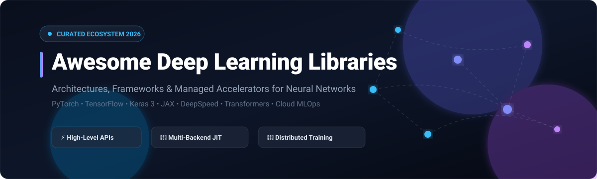

  

# 🧠 Awesome Deep Learning Libraries & Frameworks

### 🚀 A Curated List of Premier Deep Learning Libraries, Neural Network Frameworks & SaaS MLOps Platforms

  
  
  
  
  
  
  

  <b>Comprehensive directory of modern artificial intelligence (AI), machine learning (ML), and deep learning (DL) tools.</b> 
  Explore neural network architectures, high-performance automatic differentiation, distributed GPU/TPU training clusters, model fine-tuning frameworks, and production inference engines.

---

## 📑 Table of Contents

- [📊 Sector Overview & Market Dynamics](#-sector-overview--market-dynamics)
- [☁️ SaaS & Hosted AI Platforms](#️-saas--hosted-ai-platforms)
- [💻 Open-Source GitHub Frameworks](#-open-source-github-frameworks)
- [📈 Star History](#-star-history)
- [🤝 How to Contribute](#-how-to-contribute)
- [💖 Support & Sponsorship](#-support--sponsorship)
- [⚠️ Disclaimer](#️-disclaimer)

---

## 📊 Sector Overview & Market Dynamics

The global deep learning market is estimated at approximately **$125B–$178B in 2025–2026**, with the deep learning software libraries and platform segment accounting for over **$60B+** (expanding at an aggressive compound annual growth rate exceeding 35–40%). The foundational software sector is **highly concentrated and winner-take-most** among top open-source runtime frameworks (PyTorch and TensorFlow commanding the vast majority of research and enterprise production) and hyperscaler cloud AI platforms (Amazon, Microsoft, and Alphabet), while the surrounding tooling ecosystem (specialized acceleration, fine-tuning, and inference orchestration) displays moderate fragmentation.

---

## ☁️ SaaS & Hosted AI Platforms

| Product / Platform | Company / Vendor | Company Size (Market Cap / Valuation / Revenue) | Pricing (Starting Tier) | Free Tier Limits | Description & Best For |
| :--- | :--- | :--- | :--- | :--- | :--- |
| **Apple Create ML** | Apple Inc. | ~$3.5 Trillion Market Cap (~$391B Annual Revenue) | Included free with macOS / Xcode (Apple Developer Program is $99/year for distribution) | Lifetime Free (unlimited local on-device model training within macOS/Xcode on Mac hardware) | Closed-source no-code machine learning model training application and framework integrated directly into macOS and Xcode for on-device Core ML models. |
| **Google Cloud Vertex AI** | Alphabet Inc. (Google Cloud) | ~$2.1 Trillion Market Cap (~$350B Annual Revenue) | Pay-as-you-go starting at $0.00001875/1k input tokens (Gemini 1.5 Flash) or custom node training starting at $0.056/vCPU-hour and $0.35/hour for NVIDIA T4 GPU | 90-day free trial with $300 in cloud credits for all new Google Cloud accounts; Google AI Studio offers a permanent free tier up to 15 RPM / 1,500 RPD | Unified enterprise MLOps platform and managed deep learning infrastructure (supporting custom TPU/GPU training runtimes and Gemini foundation models). |
| **AWS SageMaker & Managed Deep Learning Runtimes** | Amazon.com, Inc. (AWS) | ~$2.0 Trillion Market Cap (~$600B Annual Revenue) | Pay-as-you-go starting at $0.05/hour for ml.t3.medium notebook instances or $0.28/hour for ml.g4dn.xlarge (GPU) training instances | 2-month (60-day) free trial providing 250 hours/month of ml.t3.medium notebooks or 50 hours/month of ml.m5.4xlarge training | Managed machine learning platform with integrated accelerated instances (Inferentia, Trainium, NVIDIA GPUs) and prebuilt deep learning framework containers. |
| **Databricks Mosaic AI** | Databricks | ~$43 Billion Valuation (~$2.4B ARR) | Starting at $0.07 per Databricks Unit (DBU) for Standard tier compute workloads (Compute pay-as-you-go) | 14-day free trial of full Databricks Mosaic AI platform capabilities (user covers underlying cloud infrastructure compute) | Unified end-to-end platform for fine-tuning, evaluating, deploying, and governing custom deep learning and foundation models. |
| **Lightning AI Studios** | Lightning AI | ~$150 Million Valuation | Pay-as-you-go starting at $0.18/hour for CPU cloud instances and $0.60/hour for NVIDIA T4 GPU studios; Pro plan starts at $49/month | Lifetime Free tier providing 22 free compute credits per month (equivalent to ~36 hours of free GPU/CPU compute each month) | Cloud-based collaborative development studio built by the creators of PyTorch Lightning for building, training, and deploying deep learning models. |

---

## 💻 Open-Source GitHub Frameworks

The leading open-source deep learning libraries and frameworks, sorted by GitHub Stars_Count:

1. **[TensorFlow](https://github.com/tensorflow/tensorflow)**   
   **An end-to-end open source platform for machine learning** (Apache-2.0) — The industrial standard with an extensive production deployment ecosystem, TensorBoard visualization, TensorFlow Serving, and TensorFlow Lite for edge devices.  
   *Best for:* Large-scale industrial production and mobile/edge deployments.

2. **[Hugging Face Transformers](https://github.com/huggingface/transformers)**   
   **State-of-the-art pretrained models for NLP, vision, and audio** (Apache-2.0) — The universal open standard model library providing unified APIs and seamless interoperability across PyTorch, TensorFlow, and JAX with direct access to Hugging Face Hub.  
   *Best for:* Leveraging and fine-tuning state-of-the-art transformer and multimodal pretrained models.

3. **[PyTorch](https://github.com/pytorch/pytorch)**   
   **Tensors and dynamic neural networks in Python with strong GPU acceleration** (BSD-3-Clause) — The premier deep learning framework dominating modern research, generative AI architectures, and enterprise development via dynamic computation graphs (define-by-run).  
   *Best for:* Deep learning research, rapid prototyping, and foundational AI model development.

4. **[Keras 3](https://github.com/keras-team/keras)**   
   **Deep Learning for humans** (Apache-2.0) — The unified multi-backend high-level API capable of executing seamlessly on top of JAX, PyTorch, or TensorFlow without code modifications, unlocking optimal execution speed across diverse hardware.  
   *Best for:* Teams demanding framework flexibility and intuitive modular prototyping without vendor or backend lock-in.

5. **[DeepSpeed](https://github.com/microsoft/DeepSpeed)**   
   **Extreme-scale deep learning distributed training and inference optimization** (Apache-2.0) — Microsoft's distributed optimization library featuring ZeRO (Zero Redundancy Optimizer), 3D parallelism, model compression, and high-throughput inference kernels.  
   *Best for:* Distributed large-scale model pre-training, parameter-efficient fine-tuning (PEFT), and memory-constrained multi-GPU training.

6. **[JAX](https://github.com/jax-ml/jax)**   
   **Composable transformations of Python+NumPy programs** (Apache-2.0) — High-performance numerical computing featuring automatic differentiation (`grad`), vectorization (`vmap`), distributed parallelization (`pmap`), and just-in-time compilation (`jit`) targeting TPUs and GPUs via XLA.  
   *Best for:* Cutting-edge research, scientific machine learning, and high-throughput accelerator computations.

7. **[Caffe](https://github.com/BVLC/caffe)**   
   **A fast open framework for deep learning** (BSD-2-Clause) — Berkeley's foundational deep learning library emphasizing clean architecture, configuration-driven model definitions, and high-speed C++/CUDA computer vision execution *(historical milestone; superseded by modern frameworks)*.  
   *Best for:* Legacy vision model implementations and academic study.

8. **[PyTorch Lightning](https://github.com/Lightning-AI/pytorch-lightning)**   
   **The lightweight PyTorch wrapper for high-performance AI research** (Apache-2.0) — Structured deep learning framework that decouples core engineering boilerplate (multi-node distributed training, 16-bit precision, checkpointing) from pure model architecture.  
   *Best for:* Modular, clean, production-ready PyTorch model development and scalable training pipelines.

9. **[XGBoost](https://github.com/dmlc/xgboost)**   
   **Scalable, Portable and Distributed Gradient Boosting** (Apache-2.0) — Ultra-optimized gradient boosted decision trees library with GPU acceleration, widely used side-by-side with deep neural networks for tabular features and hybrid ensemble architectures.  
   *Best for:* High-performance tabular data modeling, feature ranking, and hybrid deep learning pipelines.

10. **[fastai](https://github.com/fastai/fastai)**   
    **Layered high-level deep learning library simplifying modern best practices** (Apache-2.0) — Built on top of PyTorch, offering an expressive top-down API that provides state-of-the-art computer vision, NLP, and tabular results in very few lines of code.  
    *Best for:* Practitioners and researchers seeking rapid iteration and state-of-the-art results with minimal training boilerplate.

11. **[PaddlePaddle](https://github.com/PaddlePaddle/Paddle)**   
    **PArallel Distributed Deep LEarning: Industrial deep learning platform** (Apache-2.0) — China's flagship open-source deep learning framework developed by Baidu, combining dynamic and static graphs with automated industrial-scale distributed parallelism.  
    *Best for:* Large-scale industrial multi-hardware distributed training, computer vision, and NLP deployments.

12. **[ONNX](https://github.com/onnx/onnx)**   
    **Open Neural Network Exchange format** (Apache-2.0) — Open ecosystem interoperability specification defining an extensible computation graph model, built-in operators, and standard data formats to transfer models between frameworks (PyTorch, TensorFlow, TensorRT, OpenVINO).  
    *Best for:* Cross-platform model deployment, framework interoperability, and runtime acceleration.

13. **[Apache MXNet](https://github.com/apache/mxnet)**   
    **Lightweight, Portable, Flexible Distributed Deep Learning** (Apache-2.0) — Flexible deep learning engine combining symbolic and imperative programming with rich multi-language APIs (Python, C++, R, Scala, Julia).  
    *Best for:* Multi-language legacy environments and distributed multi-machine deployments.

14. **[Flax](https://github.com/google/flax)**   
    **A neural network library and ecosystem designed for JAX** (Apache-2.0) — Google's high-level, flexible neural network library designed to leverage JAX's composability, functional transformations, and TPU acceleration.  
    *Best for:* High-performance neural network research built natively on top of JAX.

15. **[Chainer](https://github.com/chainer/chainer)**   
    **A flexible framework of neural networks for deep learning** (MIT) — The historical pioneer of the define-by-run dynamic computation graph paradigm *(superseded; transitioned maintenance to PyTorch)*.  
    *Best for:* Historical research reference into dynamic autodiff architectures.

16. **[Lasagne](https://github.com/Lasagne/Lasagne)**   
    **Lightweight library to build and train neural networks in Theano** (BSD-3-Clause) — Early modular neural network library built on top of Theano *(superseded/archived)*.  
    *Best for:* Historical and academic reference for early modular deep learning frameworks.

17. **[PyTensor](https://github.com/pymc-devs/pytensor)**   
    **Mathematical Python library for multi-dimensional arrays and symbolic compilation** (BSD-3-Clause) — The actively maintained community fork and successor to Aesara and Theano, optimizing symbolic mathematical graphs with C, JAX, and Numba backends.  
    *Best for:* Probabilistic programming (PyMC), Bayesian neural computation, and custom symbolic math compilation.

---

## 📈 Star History

---

## 🤝 How to Contribute

Contributions are warmly welcomed! Help keep this deep learning guide comprehensive and current:

1. 🍴 **Fork the repo.**
2. 🌿 **Create a new branch** (`git checkout -b feature/awesome-addition`).
3. 📝 **Add/edit entries** in `README.md` following existing format, SEO guidelines, and verified data.
4. 🚀 **Submit a Pull Request** with a concise description of your additions.

---

## 💖 Support & Sponsorship

Thank you so much for exploring and using **Awesome Deep Learning Libraries**! If you find this curated index helpful in your machine learning research, software projects, or career development, please consider showing your support:

- ⭐ **Star this repository** on GitHub to help others discover it.
- 🍴 **Fork and share** the project with your developer communities, lab mates, and colleagues.
- ☕ **Buy a coffee & sponsor**: Support continuous maintenance, research, and open-source curation via the [GitHub Sponsors Dashboard](https://github.com/sponsors/ishandutta2007).

---

## ⚠️ Disclaimer

- This is a **community-curated** list — not an exhaustive registry nor a formal endorsement of any specific commercial vendor.
- Deep learning libraries must be evaluated for **backend flexibility**, **ecosystem maturity**, and **maintenance status**. Chainer, Caffe, and Lasagne are no longer actively developed—avoid for new projects.
- **The PyTorch vs. TensorFlow distinction:** PyTorch dominates AI research and modern generative modeling; TensorFlow remains prevalent across mature enterprise serving and mobile infrastructure.
- **Keras 3's multi-backend capability:** Allows seamless execution on JAX, PyTorch, or TensorFlow, providing 20% to 350% potential speed improvements by selecting the optimal hardware engine.
- Self-hosted open-source solutions require proper GPU provisioning, dependency management, and ongoing maintenance.

---

**Made with ❤️ for ML engineers, researchers, and organizations building transparent deep learning solutions.**  
Let's make Deep Learning Libraries more open, data-driven, and flexible.

